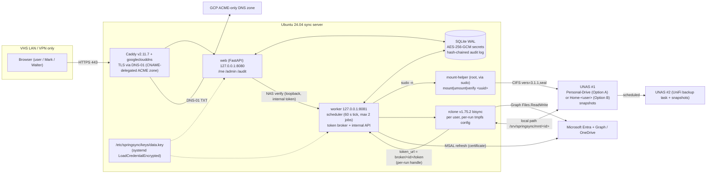

# SpringSync (working name), v0.1 lab build

SpringSync is a small service for the Visit Hot Springs LAN. It keeps each person's **OneDrive for Business**
and their **UniFi NAS home folder** in two-way sync, using one `rclone bisync` job per user.

- **Users** connect themselves on an internal page: they sign in with Microsoft, then enter their NAS login once.
  Each person has their own status page.
- **Admins** (Mark) change settings and run user actions in a GUI: NAS address, schedule, alerts, pilot list,
  Entra groups, pause/resume, approve resync, offboard.
- **Auditors** (Walter) get a strictly read-only status page and audit-log view.

> **Status: lab-only v0.1.** Nothing has been deployed. The build spec is `../SPEC.md` (source of truth) and the
> background research is `../research.md`. `OPEN-QUESTIONS.md` lists everything that blocks a pilot.

The product name is not final. The Python package is deliberately neutral (`odnas`). The display name and the
*slug* (which drives paths, unit names, and the check/archive file names) are config values:
`product_name` / `slug`, defaulting to `SpringSync` / `springsync`.

## Architecture



**How a sync run works** (SPEC §9.2, `odnas/runner.py`):
1. The scheduler picks the user (stagger slot, active hours, concurrency limit, one run per user).
2. The NAS share is mounted through the helper. With Option A this uses the user's own login, decrypted
   only for this run and written to a 0600 file on tmpfs.
3. A per-run rclone config is written to `/run/springsync/rclone/<id>.conf`. In **broker mode** it holds only
   a random per-run handle and `token_url` pointing at the local broker. The broker uses MSAL with the
   certificate to swap the real refresh token for a short-lived access token, and stores the rotated
   refresh token re-encrypted. This is pending lab test T-A3. The **tmpfs_config fallback** puts the real
   refresh token plus the client secret in the tmpfs config and reads the rotated token back afterwards.
4. `rclone bisync` runs with the SPEC §9.3 flag set (including `--color NEVER`) and a worker-enforced time
   limit (25 min for incremental runs). When the limit is hit the worker sends SIGINT once, waits 120 s, then SIGKILL.
5. The worker classifies the run from the exit code **plus the exact v1.75.2 log text** (SPEC v0.2 §9.4),
   updates state and issues, unmounts, and shreds the temp files. Steps 2–5 always clean up in `finally`.

**Classifier (SPEC v0.2 §9.4, `odnas/classify.py`)**, checked in this order:

| Check | Result |
|---|---|
| broker / log auth error | `auth` → `needs_reauth` or `blocked_by_ca` |
| worker time limit hit | `timeout` (continues at the next slot) |
| exit 0 + `Bisync successful` | `ok` |
| `object="Safety abort"` + `too many deletes (>N%, X of Y) on PathN …`, or `Safety abort: all files were changed …` (expected with exit 1) | **`safety_abort`** |
| exit 7 + `Bisync aborted. Must run --resync to recover.` | `critical` (lockout) |
| exit 7 + `Bisync aborted. Error is retryable without --resync due to --resilient mode.` | `critical_retryable`: the next run proceeds, but it escalates to `critical` (pause + alert) immediately on `Access test failed:`, on the same error twice in a row, or on the 3rd in a row (SPEC v0.3) |
| exit 7 with neither line, or exit code and log text disagree | `critical` (fail safe, warning logged) |
| exit 2 | `usage` (bug: user paused, high issue) |
| exit 1, 3, 4, 5, 6, 8, 10, or killed by a signal | `retryable` |
| NAS mount failed, rclone never started (SPEC v0.4) | `retryable`, but **outside** the same-error chain (neither counts nor resets it); separate counter, admin alert after 2 in a row, no lockout. Only a **successful mount** resets the counter (v0.5) |
| NAS rejected the login (wrong password), Option A | `nas_auth` → that user `nas_auth_failed`: paused at once, no retries, own alert; leaves the mount-failure counter unchanged (v0.5) |
| NAS rejected the shared `svc-sync` login, Option B (v0.6) | `nas_auth` → **one server-wide NAS pause** (`worker_state` row `nas_global_pause`), one `high` alert, no retries, no user state changed; banner on the admin dashboard, Settings and auditor view. Clears automatically once a new `nas_svc_password` is saved and a test mount with it succeeds (a rejected new password is never retried). The test mount (worker's next tick, ≤60 s; Settings shows "Testing new password…") and the routine 15-min NAS health check (`medium` alert after 2 consecutive failures, v0.8) both use the svc-sync-only **health-check share** (`nas_health_share`, default `Sync-Health`), never a user's `Home-<user>` share. Creating that share is a manual NAS step that needs Mark's OK (docs/DEPLOY.md); `install.sh` only prints a reminder |

Value names (`users.state`, `sync_runs.result`, `sync_runs.kind`) match SPEC v0.4 §5 exactly; a test
compares the code's lists with the spec text.

**User lifecycle:**
- **Onboarding:** `onboarding` → Microsoft connect → NAS login verified → preflight filename scan →
  `--resync --dry-run` → admin clicks **Approve initial sync** → real `--resync` (one user at a time, inside
  the resync window) → `active`.
- **Failure states:**
  - `needs_reauth` / `blocked_by_ca` (from the broker or the rclone log);
  - `nas_auth_failed` (paused, no retries);
  - `critical` (exit-7 lockout; needs **Approve resync**);
  - `safety_abort` (see below);
  - `paused` (admin action or rclone usage error).
- **Safety abort** (a tripped `--max-delete` or "all files changed"): nothing was synced, and a plain run
  would trip again every slot, so the user is paused.
  1. The worker runs a read-only `bisync --dry-run --force` to build a delta list. The list holds file names,
     so it is kept in a 0600 file and shown on the IT-admin page only.
  2. The admin then chooses one of two actions, both audited and single use (SPEC v0.4 §9.4.1):
     - **Restore:** one `--resync --resync-mode newer`. It copies the deleted files back.
       - **Next slot** (default): normal 25-minute limit. If it hits the limit it is **re-queued once as a
         tonight run** automatically (audited, admin notified, no new approval: resync never deletes).
       - **Run tonight**: waits for `resync_hours` (not bound by active hours) and may run until the window
         closes (07:00 CT). It starts only with **at least 30 minutes left**; otherwise it is held for the
         next night (audited once per night; `low` alert, `medium` if the same Restore is held a second
         night; per-Restore count `tonight_hold_nights`, reset by a new Restore). If it is still running at 07:00, it is stopped, the
         user stays paused and the admin is alerted (click again).
     - **Accept deletes:** the admin approves the delete count **for each side** (Path1 = OneDrive,
       Path2 = NAS) and types the UPN to confirm. Normal run-time limit.
       - The approval expires after 24 h.
       - Just before the run, a dry-run recounts the deletes. If **either side's** count differs, the run is
         cancelled, the approval voided and the admin alerted. The recount is its own run row, before the
         `force` row.
       - A NAS mount failure before the run does not use up the approval.
       - If the `--force` run times out or fails, the user stays paused, and it never re-runs on its own.
  3. Success sets the user back to `active`.
  4. **During onboarding** (SPEC v0.5 §6.1 step 8): onboarding counts as complete only after the first
     successful normal bisync. An abort on the onboarding dry run or the first bisync is handled the same
     way, onboarding stays incomplete, and **Restore re-runs the onboarding `--resync`** (resync window, one
     at a time, no time limit). An abort on the onboarding dry run has no bisync listings, so no delta list
     can be built and only Restore is offered: it goes straight to the real `--resync` (no fresh dry run;
     safe because resync never deletes) and the click is audited as `admin_first_sync_approved_via_restore`.
  5. Walter sees the counts and decision state, but not the list or the buttons. The list has its own
     IT-admin-only page, and every view of it is audited (§14.13, pending Walter's sign-off).
- **Offboarding:** admin clicks **Offboard** → optional final sync → crypto-erase (credential rows deleted with
  `secure_delete`, then `VACUUM`) → workdir removed → `removed`.

**Service mode** (SPEC v0.8 §9.5, `odnas/service_mode.py`), for planned bulk work such as a cleanup,
reorganisation or NAS move:
- **Scope:** an IT admin turns it on for **all users** (dashboard switch, typed confirmation `ALL USERS`;
  `worker_state` row `service_mode_global`) and/or for **selected accounts** (dashboard picker or the
  user's page; `sync_profiles.service_mode_until`).
- **Window:** each needs a reason and an end time: default 4 h, 1-24 h. Re-enabling extends it.
  **Turn off now** ends it at once.
- **Effect:** covered users' scheduled bisync runs use `--max-delete 100` (never trips; omitting the flag
  would mean rclone's 50% default). **Never `--force`.** The all-files-changed abort, `--check-access`
  (an empty or unmounted side has no check file), filters, the run-time limit and the lockout rules all
  stay. Deletes still go to `.springsync-archive`. Real-rclone integration tests cover all of this.
- **Not applied to:** onboarding-incomplete users, Restore / Accept deletes / delta lists / resyncs, users
  already paused (an existing `safety_abort` stays), or while `nas_global_pause` blocks runs.
- **Ending:** it ends on its own at the stored end time, also after a restart. A run started inside the
  window keeps its flags.
- **Record:** each run is tagged `sync_runs.service_mode` (`all`/`user`) with per-side delete counts
  (`deletes_path1`/`deletes_path2`).
- **Audit and alerts:** on, off, extend and expire are audited. On raises a `low` alert; the end raises a
  summary alert with deletes per user per side (counts only).
- **Visibility:** a banner and status row for admins and auditors (Walter: read-only, no buttons).

## Repository layout

```
odnas/                 the app (SPEC "app/"): web, worker, broker, models, migrations
  config.py            bootstrap config (TOML + ODNAS_* env), no secrets
  crypto.py            AES-256-GCM keyring, key_id rotation
  db.py                SQLite schema + expand-only migrations, audit hash chain
  settings_store.py    GUI-editable settings (validated, audited, secrets write-only)
  entra.py             MSAL wrapper behind EntraClient + AADSTS classifier
  tokens.py            TokenStrategy: BrokerTokenStrategy (default) / TmpfsConfigStrategy (fallback)
  nas.py               NasAccessProvider: PersonalDriveProvider (A) / SharedHomeProvider (B)
  bisync.py            exact rclone command builders
  classify.py          exit-code + JSON-log classification
  preflight.py         blocked names, 400-char paths, 250 GB, case collisions, >100k items
  scheduler.py         stagger, windows, weekly check, throttle governor
  runner.py            one job end to end
  worker.py            tick loop, offboarding, broker/internal HTTP app
  maint.py, rekey.py   nightly maintenance, backups, key rotation
  web/                 FastAPI app + Jinja templates (no JavaScript)
deploy/
  install.sh update.sh rollback.sh RESTORE.md
  systemd/  caddy/  sudoers/  mount-helper  filters/bisync-filters.txt.tmpl  config/springsync.toml.example
tests/                 pytest (unit, web/security, real-rclone integration)
requirements.in / requirements.lock (pip --require-hashes)
```

## Run the tests

```bash
python3 -m venv .venv && .venv/bin/pip install --require-hashes --no-deps -r requirements.lock
.venv/bin/python -m pytest -q            # everything
.venv/bin/python -m pytest -q --smoke    # the subset update.sh runs against a new release
ODNAS_TEST_RCLONE=/path/to/rclone-v1.75.2 .venv/bin/python -m pytest -q -m integration
```
MSAL, Graph, the NAS, and the mount helper are all faked in the tests. No test makes a network call.
The integration tests run the **real** rclone v1.75.2 between two local directories using our exact flags.
They are skipped if no rclone binary is found.

## Setup

### Lab / development
1. Copy `.env.example` to `.env`, then export its values. Put a 32-byte `data.key` (`head -c32 /dev/urandom`)
   in `ODNAS_KEYS_DIR`.
2. Run `python -m odnas db-upgrade`, then `python -m odnas check-config`.
3. Run `python -m odnas web` and `python -m odnas worker`. Real sign-in needs a lab Entra app registration
   (see OPEN-QUESTIONS).

### Server (Ubuntu 24.04), after the SPEC §11.1 prerequisites
```bash
sudo REPO_URL=git@github.com:<OWNER>/<REPO>.git TENANT_ID=... CLIENT_ID=... \
     GROUP_USERS=... GROUP_ADMINS=... GROUP_AUDITORS=... \
     SYNC_HOST=sync.hotsprings.org GCP_ACME_PROJECT=... ACME_ZONE=... \
     LAN_CIDRS="10.0.0.0/16" ADMIN_CIDR="10.0.10.0/24" LOG_READERS="walter" \
     ./deploy/install.sh --version v0.8.0           # add --dry-run to see the plan first
```
`install.sh` is idempotent: every step checks state first, and it never overwrites keys, the DB, or settings.
It handles:
- packages and unattended security upgrades;
- users and directories;
- the pinned, checksum-verified rclone;
- a Caddy custom build with xcaddy and the pinned plugin;
- the app release and venv;
- keys and `systemd-creds`;
- config;
- the DB;
- sudoers and the mount helper;
- ufw;
- systemd units that start at boot and restart on failure;
- a smoke test.

Updates: `sudo /opt/springsync/current/deploy/update.sh vX.Y.Z`. Rollback:
`sudo /opt/springsync/current/deploy/rollback.sh [--restore-db]`. See `docs/DEPLOY.md`.

## Configuration reference

### Bootstrap (`/etc/<slug>/<slug>.toml`, or `ODNAS_<KEY>` env vars; never secrets)
| Key | Default | Notes |
|---|---|---|
| `product_name` / `slug` / `org_name` | `SpringSync` / `springsync` / `VisitHotSprings` | slug drives paths, units, `.<slug>-check`, `.<slug>-archive`; User-Agent `NONISV|<org>|<product>/<major.minor>` (e.g. `SpringSync/0.2`) |
| `base_url` | `https://sync.hotsprings.org` | redirect URI = base_url + `/auth/callback` |
| `web_host:web_port`, `broker_host:broker_port` | `127.0.0.1:8080`, `127.0.0.1:8081` | non-loopback is refused |
| `tenant_id`, `client_id` | – | GUIDs; `common`/`organizations` refused |
| `credential_type` | `certificate` | or `secret` (fallback) |
| `cert_path` | – | public cert; its expiry drives the admin countdown |
| `token_mode` | `broker` | `tmpfs_config` fallback (requires `secret`) |
| `allowed_upn_domain` | – | e.g. `hotsprings.org` |
| `group_users` / `group_admins` / `group_auditors` | – | bootstrap only; the GUI overrides them |
| `db_path`, `state_dir`, `log_dir`, `runtime_dir`, `mount_root`, `keys_dir`, `etc_dir` | derived from slug | see SPEC §8.2 |
| `rclone_bin` | `/usr/local/bin/rclone` | |
| `nas_host`, `nas_share` | `unas.hotsprings.local`, `Personal-Drive` | bootstrap defaults for the GUI |

### Secrets (files only; `$CREDENTIALS_DIRECTORY` via `LoadCredentialEncrypted=`)
| Name | Purpose |
|---|---|
| `data.key` | 32-byte AES-256-GCM data key (`data.key.old` is optional during rotation) |
| `entra-app.key` | Entra app certificate private key |
| `entra-client-secret` | fallback client secret (secret mode / tmpfs_config only) |

### GUI settings (DB `settings` table; admin page; every change audited)
| Group | Key | Default | Secret |
|---|---|---|---|
| NAS | `nas_option` (A/B), `nas_host`, `nas_share`, `nas_shared_template`, `nas_svc_username`, `nas_domain` | `A`, `unas.hotsprings.local`, `Personal-Drive`, `Home-{user}`, `svc-sync`, – | |
| NAS | `nas_svc_password` (Option B) | – | yes |
| Schedule | `default_interval_min`, `active_hours`, `max_concurrent`, `run_time_limit_min`, `resync_bwlimit`, `resync_hours`, `stale_hours` | `30`, always, `2`, `25`, –, `18:00-07:00`, `24` | |
| Safety | `default_max_delete_pct`, `check_weekday`, `check_time` | `10`, `6` (Sun), `03:00` | |
| Alerts | `alert_recipients`, `smtp_host`, `smtp_port`, `smtp_starttls`, `smtp_username` | –, –, `587`, on, – | |
| Alerts | `smtp_password` | – | yes |
| Pilot | `pilot_only`, `pilot_list` | on, empty (nobody) | |
| Entra | `group_users`, `group_admins`, `group_auditors`, `entra_credential_expires_on` | –, –, –, – (auto-read from the certificate when set) | |

Secret fields can only be replaced, never viewed. **Email is not sent in v0.1:** alerts appear as issues on the
admin and auditor pages. `odnas.notify.Notifier` is the plug-in point once the mail path is decided.

## CLI
`odnas web | worker [drain|undrain] | maint | backup [--tag] | db-upgrade | check-config | verify-audit | rekey | notify --unit X`
